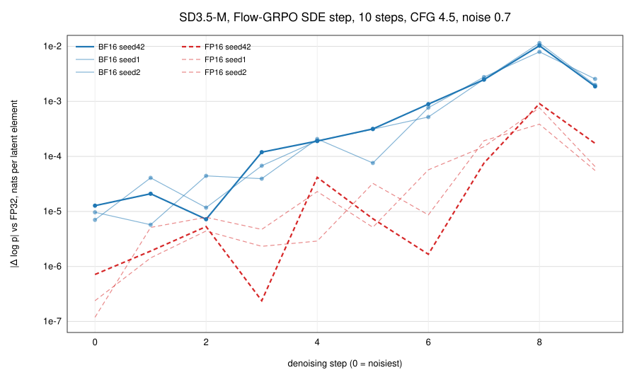

# Fast fail: diffusion RL rollout–trainer log-prob mismatch

Date: 2026-11-05 (run 08:14–17:00 PST). Hardware: 1× RTX PRO 6000 Blackwell Max-Q (SM120), driver 615.71.09.
Question: in Flow-GRPO-style diffusion RL (each denoising step is a policy action with a Gaussian log-likelihood), how much do per-step log-probs from the rollout engine differ from the trainer's, and does it change GRPO outcomes? This is a GO / NO-GO check in four gates, not the study itself.

| Gate | Result | Evidence |
|---|---|---|
| 1 vLLM-Omni exposes per-step quantities | **SMALL PATCH** | No stock per-step mean/sigma/noise/log-prob for Qwen-Image, FLUX, SD3, Wan, LTX-2 at `vllm-project/vllm-omni@04ddf21`. `output_metadata.py:47-52` has an RL trajectory slot (`latents`, `timesteps`, `log_probs`) filled only by BAGEL. `CFGParallelMixin.scheduler_step` (`cfg_parallel.py:563`) keeps only `prev_sample`. A `custom_pipeline_args.pipeline_class` subclass with an SDE scheduler works without engine changes (UniRL, verl-omni do this). Scheduler injection still open: RFC #6269, PR #6277. Details: [docs/fastfail-gate1-vllm-omni.md](../docs/fastfail-gate1-vllm-omni.md). |
| 2 Problem still open | **PARTLY DONE** | Measurement largely done in public: verl-omni #280 (mean \|Δlogp\| 2.2e-5–5.9e-5 matched backends; SD3.5-M, Qwen-Image on sm_120, BAGEL) and merged PR #291 (`rollout_corr/logprob_abs_diff_*`). Open: a controlled test of whether the mismatch changes GRPO outcomes; same pipeline across GPUs; SM121; fp16/NVFP4 arms; multiple seeds. Scoop risk: verl-omni #700 Q4 roadmap "0-diff … for diffusion models", no PR found. Details: [docs/fastfail-gate2-prior-work.md](../docs/fastfail-gate2-prior-work.md). |
| 3 Reference trains on SM120 | **RUNS WITH PATCH** | `yifan123/flow_grpo@879042c`, `general_ocr_sd3_1gpu` (SD3.5-M LoRA, 512 px, 10 steps, CFG 4.5, OCR reward), 1 GPU. ~50 logged optimizer steps, OCR reward logged every epoch (≈0.38 at epochs 11–14, 0.51–0.59 at 18–23, 0.36 at 24), no NaN/inf, ≈10.75 s per training step, peak 64,000 MiB (≈62.5 GiB) on GPU 0. Patches: torch 2.8.0+cu128 instead of pinned 2.6.0 (2.6.0 wheel lists sm_50…sm_90 only); `opencv-*-headless` (no libGL on host); deepspeed not installed (unused). Ran past `num_epochs: 20` (stopped manually at epoch 25; cause not investigated). |
| 4 Mismatch probe | **numbers below** | FP32 vs BF16 transformer, same GPU, same sampled trajectory, Flow-GRPO's own `sde_step_with_logprob`. |

## Gate 4 numbers

Setup: prompt = first line of `dataset/ocr/test.txt`; SD3.5-M; 10 SDE steps, CFG 4.5, noise_level 0.7, 512 px; TF32 off. Trajectory sampled once in FP32 with `pipeline_with_logprob`; each transition x_t → x_{t-1} re-scored with the transformer in FP32, BF16 and FP16. Recomputed FP32 equals the sampler's log-prob exactly (max diff 0.00e+00, all seeds). Latent = 65,536 elements; Flow-GRPO's log-prob is the mean over elements, "summed" = mean × 65,536.

Primary (seed 42):

| step | log p FP32 (per elem) | \|Δ\| BF16 per elem | \|Δ\| BF16 summed | \|Δ\| FP16 per elem | max \|Δ mean\| BF16 |
|---|---|---|---|---|---|
| 0 | -1.06922 | 1.28e-05 | 0.8 | 7.2e-07 | 1.0e-02 |
| 1 | -1.12475 | 2.10e-05 | 1.4 | 1.9e-06 | 2.1e-02 |
| 2 | -0.79812 | 7.21e-06 | 0.5 | 5.3e-06 | 2.3e-02 |
| 3 | -0.60872 | 1.20e-04 | 7.8 | 2.4e-07 | 5.2e-02 |
| 4 | -0.48538 | 1.90e-04 | 12.5 | 4.2e-05 | 4.4e-02 |
| 5 | -0.37913 | 3.16e-04 | 20.7 | 7.4e-06 | 6.7e-02 |
| 6 | -0.27347 | 8.91e-04 | 58.4 | 1.7e-06 | 1.9e-01 |
| 7 | -0.15144 | 2.49e-03 | 162.9 | 7.6e-05 | 1.8e-01 |
| 8 | 0.07083 | 1.03e-02 | 675.0 | 9.1e-04 | 4.7e-01 |
| 9 | 3.65543 | 1.88e-03 | 122.9 | 1.7e-04 | 2.2e-03 |

Max over steps: BF16 1.03e-2 nats per element (675 nats summed); FP16 9.1e-4 per element.

Robustness (BF16, per element, steps 0–9):
- seed 1: 7.0e-06 4.1e-05 1.2e-05 6.8e-05 1.9e-04 3.1e-04 5.2e-04 2.5e-03 1.2e-02 2.0e-03
- seed 2: 9.7e-06 5.7e-06 4.4e-05 3.9e-05 2.1e-04 7.6e-05 7.7e-04 2.8e-03 7.9e-03 2.6e-03

Prediction recorded before the run: "1e-3, grows across steps".

Numbers: [results/diffusion-rl-fastfail-gate4.json](../results/diffusion-rl-fastfail-gate4.json) (all seeds, all arms, per step). Gate 3 training history: [results/diffusion-rl-fastfail-gate3-history.jsonl](../results/diffusion-rl-fastfail-gate3-history.jsonl). Code: [scripts/fastfail/](../scripts/fastfail/). Raw latent arrays (33 MB) are kept off-repo.

## Decision

**GO.** Rule: Gate 2 = OPEN or PARTLY DONE, Gate 3 = RUNS or RUNS WITH PATCH, Gate 1 ≠ NO. All three hold.

**Biggest risk:** scooping and framing. The rollout-vs-trainer measurement already exists publicly (verl-omni #280, #291) and verl-omni's Q4 roadmap lists diffusion "0-diff". The contribution has to be the outcome question (does the mismatch change GRPO results), which needs a design where the mismatch actually enters the PPO ratio. In verl-omni's default the trainer replays `old_log_probs`, so only `bypass_mode=True` puts it there.

**Next 3 steps:**
1. Rerun Gate 4 with vLLM-Omni as the rollout engine (subclass route from Gate 1) against the trainer on the same GPU, to compare engine-vs-trainer with the precision gap measured here.
2. Controlled A/B on the Gate 3 setup: same seeds, rollout in BF16 vs FP32 (and FP16), with the mismatch in the ratio, ≥3 seeds, reward curves. This is the open part of Gate 2.
3. Repeat Gates 3–4 on the Spark (SM121) to cover the GPU axis nobody has measured.

## Explanation (Carmen)

?
